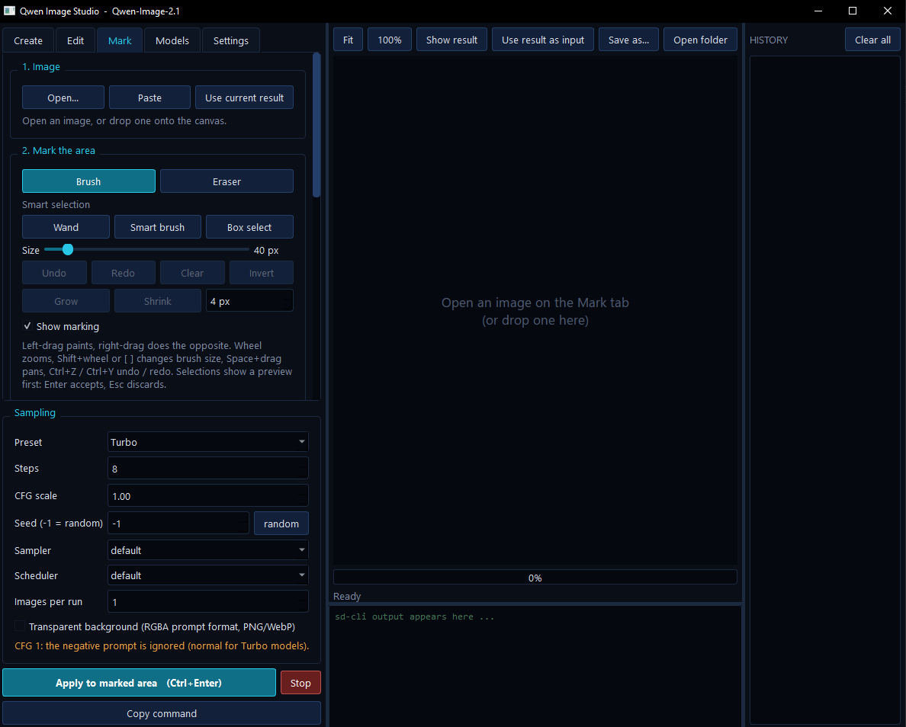

<div align="center">

# Qwen Image Studio

**A desktop studio for Qwen-Image-2.1 GGUF models: text-to-image, prompt-based editing, and paint-to-edit with smart selection.**


</div>


<p align="center">
  
</p>

Qwen Image Studio is a single-file Python application that puts a dark, dense interface on top of
[stable-diffusion.cpp](https://github.com/leejet/stable-diffusion.cpp)'s `sd-cli`. It loads **any**
Qwen-Image-2.1 GGUF (every quant, Standard or Turbo) and lets you generate images, edit existing ones
with plain-language instructions, or paint over the part of a picture you want changed.

It runs locally. Your prompts and images never leave your machine, except for the optional model and
runtime downloads.

---

## Contents

- [Features](#features)
- [Requirements](#requirements)
- [Quick start](#quick-start)
- [Model files](#model-files)
- [Using the studio](#using-the-studio)
  - [Create](#create)
  - [Edit](#edit)
  - [Mark](#mark)
  - [History and outputs](#history-and-outputs)
- [Standard and Turbo presets](#standard-and-turbo-presets)
- [Settings for low VRAM](#settings-for-low-vram)
- [Keyboard and mouse reference](#keyboard-and-mouse-reference)
- [Troubleshooting](#troubleshooting)
- [Where things are stored](#where-things-are-stored)
- [How it works](#how-it-works)
- [Limitations](#limitations)
- [License](#license)

---

## Features

**Generation**
- **Create**: text-to-image with prompt and negative prompt, size presets or custom size, steps, CFG,
  seed, sampler, scheduler and batch count. Optional transparent-background output (RGBA prompt format).
- **Edit**: drop in one or more images and describe the change: add, remove or replace objects, change
  style or background, edit text inside the picture. Built-in prompt templates and "match input image" output size.
- **Mark**: paint over the area to change, then say what should happen there. The area outside your marking
  can be kept pixel-identical. An optional **focus mode** edits a crop around the marking for better detail on small objects.

**Smart selection (no extra libraries or models)**
- **Wand**: click to select the connected area of similar color, with an adjustable tolerance.
- **Smart brush**: scribble on the object and the selection snaps to its edges. A right-button scribble marks background.
- **Box select**: drag a box around an object and it selects what differs from its surroundings.
- Every selection is shown as a preview first: **Enter** accepts it, **Esc** discards it. Add or subtract, then Grow / Shrink the mask by a pixel amount.
- Implemented with plain color and edge analysis in Python and Qt, so there is no SAM model, ONNX runtime or NumPy to install.

**Models and runtime**
- **Universal GGUF loading**: the quantization is read from the file by the runtime, so Q2_K to Q8_0, K-quants,
  mixed-precision builds, distilled builds and safetensors all work.
- **Standard / Turbo presets** that switch automatically when a file name contains "Turbo".
- **Check files**: verifies that each model file is complete, readable and in the right field, and names the file that is wrong.
- Built-in downloaders for `sd-cli` releases, companion files (VAE, text encoder, vision projector) and any Hugging Face GGUF.
- Model auto-detection for a whole folder.

**Workflow**
- Live progress with elapsed time and a runtime log panel, cancel at any time.
- Thumbnail history with per-image settings, "reuse settings and prompt", and a one-click **Clear all**.
- Every result is saved as a PNG together with a JSON file holding the prompt, seed and settings.
- Friendly diagnostics for common failures (out of memory, unrecognised model, missing files).

---

## Requirements

| | |
|---|---|
| **Python** | 3.9 or newer (developed and tested on 3.13) |
| **Python packages** | `PyQt6` (everything else is the standard library) |
| **Runtime** | `sd-cli` from stable-diffusion.cpp, downloadable from inside the app |
| **GPU** | Recommended. NVIDIA (CUDA 12 build), AMD/Intel (Vulkan build) or CPU-only builds are offered by the downloader |
| **Disk** | Several GB for the model, text encoder and VAE |

Developed and used on Windows with an RTX 3060 (12 GB VRAM) and 24 GB RAM, using the CUDA 12 build of
stable-diffusion.cpp. The downloader also lists Linux and macOS builds; those have not been tested with real generation.

---

## Quick start

```bash
pip install PyQt6
python qwen_image_studio.py
```

Then, in the **Models** tab:

1. Click **Get sd-cli...** and choose the build for your hardware. For an NVIDIA card, select the `cuda12` archive
   **and** the matching `cudart` archive, then **Download & install selected**.
2. Click **Download companions** to fetch the VAE, the Qwen3-VL-8B text encoder and its vision projector.
3. Set the **Diffusion model** to your Qwen-Image-2.1 GGUF, or use **Download from Hugging Face...** to pick one.
4. Press **Check files** to confirm everything is complete.
5. Open **Create**, type a prompt and press **Ctrl+Enter**.

---

## Model files

Four files take part in every run. All are set on the **Models** tab.

| Field | What goes there | Notes |
|---|---|---|
| **Diffusion model** | A Qwen-Image-2.1 `.gguf` or `.safetensors` | Any quant. Standard or Turbo. |
| **VAE** | `qwen_image_2.1_vae_bf16.safetensors` | Fetched by *Download companions*. |
| **Text encoder (LLM)** | Qwen3-VL-8B-Instruct, GGUF or safetensors | The Q4_K_M GGUF is a good default. |
| **Vision projector** | `mmproj-Qwen3VL-8B-Instruct-F16.gguf` | Required for **Edit** and **Mark** when the text encoder is a GGUF. |

> The text encoder is a language model that turns your prompt (and, when editing, your image) into the signal the
> diffusion model draws from. It does not generate images or video by itself.

If you use a modified or fine-tuned Qwen3-VL encoder, it must be the same architecture, and it needs a matching
vision projector for Edit and Mark.

The default companion downloads come from:
- VAE: [`Comfy-Org/Qwen-Image-2.1`](https://huggingface.co/Comfy-Org/Qwen-Image-2.1)
- Text encoder and projector: [`Qwen/Qwen3-VL-8B-Instruct-GGUF`](https://huggingface.co/Qwen/Qwen3-VL-8B-Instruct-GGUF)

For gated or private repositories, set the `HF_TOKEN` environment variable before starting the app.

---

## Using the studio

### Create

Write a prompt, choose a size and press **Generate** (**Ctrl+Enter**). Pick a **Standard** or **Turbo** preset in the
Sampling box, or tune steps, CFG, seed, sampler and scheduler yourself. Tick **Transparent background** to use the
official RGBA prompt format and get a PNG or WebP with an alpha channel. Set **batch** above 1 to render several images in one run.

### Edit

Drag one or more images into the input list (or paste from the clipboard with **Ctrl+V**), describe the change, and generate.
The **Insert a template...** list offers starting points such as *Remove an object*, *Replace an object*, *Change background*,
*Edit text in image* and *Make background transparent*. The output size can match the input image.

### Mark

1. **Open an image** (**Open...**, **Paste**, drag and drop, or *Mark & edit this image* from the history).
2. **Mark the area** with the Brush, or let a smart tool outline it for you.
3. **Say what should happen** in the marked area: add, remove or change something.
4. Choose how the marking is shown to the model and press **Generate**.

| Tool | How to use it |
|---|---|
| **Brush / Eraser** | Paint or rub out. Right-drag does the opposite. Size from the slider, `[` / `]` or Shift + mouse wheel. |
| **Wand** | Click an area. **Tolerance** controls how similar a color must be. Untick *Contiguous only* to select that color everywhere. |
| **Smart brush** | Scribble lightly with a small brush. The selection updates after each stroke. Right-scribble the background to exclude it. |
| **Box select** | Drag a tight box around the object. Raise **Reach** if parts are missing, lower it if too much is selected. |

Smart selections appear as a preview (cyan to add, amber to subtract). Press **Enter** to accept or **Esc** to discard.
Starting a new selection accepts the previous one, and **Ctrl+Z** discards a pending selection before undoing anything else.
**Precision** (Fast / Normal / Fine) trades speed for detail. **Invert**, **Clear**, **Grow** and **Shrink** work on the whole mask.

**Options for the edit**

| Option | Effect |
|---|---|
| Marker color and style | How the marking is drawn on the picture the model sees: Tint, Solid or Outline in Magenta, Red, Green, Blue, Yellow or Cyan. |
| Add 'marked area' instructions | Wraps your text so the model knows what the marking means. |
| Keep everything outside the marking identical | The result is composited back through your mask, with an adjustable **feather**, so the rest of the image stays untouched. |
| Focus mode | Crops around the marking (with padding), edits the crop at full resolution, and pastes it back. Best for small objects. |
| Also send the unmarked image as reference 1 | Gives the model a clean copy of the original alongside the marked one. |

### History and outputs

Every result is added to the history panel on the right. Hover a thumbnail for its prompt and settings. Right-click for
*Use as edit input*, *Mark & edit this image*, *Reuse settings & prompt*, *Show in folder*, *Copy path* and *Delete...*.
**Clear all** removes the whole history at once. It asks for confirmation first and sends the files to the Recycle Bin where the system supports it.

Each image is saved as `<timestamp>_<mode>_s<seed>.png` with a JSON file of the same name that records the prompt,
negative prompt, seed, size, steps, CFG, sampler and scheduler.

---

## Standard and Turbo presets

| Preset | Steps | CFG | When |
|---|---|---|---|
| **Standard** | 30 | 6.0 | Regular Qwen-Image-2.1 files. |
| **Turbo** | 8 | 1.0 | Distilled Turbo builds. Selected automatically when the diffusion model's file name contains "turbo". |

With CFG 1 the negative prompt is ignored, which is normal for Turbo. If you change a value by hand the preset switches to **Custom**,
and a loaded model of the same kind never overwrites your custom values.

---

## Settings for low VRAM

The **Settings** tab holds the memory and speed switches:

- **Offload weights to CPU RAM**: on by default, recommended for 12 GB of VRAM or less.
- **VAE tiling** and **Run VAE on CPU**: reduce memory when decoding large images.
- **Run text encoder on CPU**: frees more VRAM for the diffusion model.
- **Flash attention** for the diffusion model.
- **Prefix cache**: faster, but uses about 4 GB of extra memory per condition. Turn it off if you run out of memory.
- **Extra arguments**: any additional `sd-cli` flags, passed through as written.

If a run fails with an out-of-memory message, try a smaller resolution, a smaller quant, offload on, VAE tiling on, text encoder on CPU, or prefix cache off.

---

## Keyboard and mouse reference

| Action | Input |
|---|---|
| Generate | `Ctrl+Enter` |
| Stop the current run | `Esc` |
| Paste an image | `Ctrl+V` |
| Undo / redo the mask | `Ctrl+Z`, `Ctrl+Y` or `Ctrl+Shift+Z` |
| Accept / discard a pending selection | `Enter` / `Esc` |
| Brush size | `[` and `]`, or `Shift` + mouse wheel |
| Zoom | Mouse wheel |
| Pan | Middle-drag, or hold `Space` and drag |

---

## Troubleshooting

| Message | Likely cause and fix |
|---|---|
| `get sd version from file failed` | The runtime could not identify the model from the files it was given. Press **Check files**. The usual causes are an incomplete or corrupted model download (download it again) or a file in the wrong field. |
| "This sd-cli build does not recognise the model" | The runtime does not know this model type. Install a newer release with **Get sd-cli...**. |
| "The runtime ran out of memory" | See [Settings for low VRAM](#settings-for-low-vram). |
| "Editing with a GGUF text encoder needs the vision projector" | Set the **Vision projector** (mmproj) on the Models tab. |
| The CUDA build will not start | Install the matching `cudart` archive from the same release and update your NVIDIA driver. The Vulkan build is a slower fallback that works on most GPUs. |
| Smart selection picks the wrong area | Switch tool, adjust Tolerance or Reach, add a background scribble, or finish with the Brush. |

The **log panel** at the bottom of the window shows the full `sd-cli` output and the exact command line used for each run.

---

## Where things are stored

Everything lives under `~/QwenImageStudio` unless you set the `QWEN_STUDIO_HOME` environment variable.

| Path | Contents |
|---|---|
| `settings.json` | Your settings. |
| `models/` | Default download location for model files. |
| `tools/sd-cpp/<release>/` | Runtime builds installed by the app. Each release gets its own folder. |
| `outputs/` | Generated images and their JSON files. Configurable on the Settings tab. |
| `clipboard/` | Images pasted from the clipboard. |

---

## How it works

The studio builds an `sd-cli` command line from your settings and runs it as a child process, then reads progress from its output.
Because the runtime reads the quantization from the file, the program is not tied to any one quant.

The Mark tab works around the fact that the model has no mask input. It draws your marking on the picture, wraps your prompt so the
model knows what the marking means, and then, in strict mode, composites the result back through a feathered version of your mask so
everything outside the marking stays identical. Focus mode does the same on a crop.

Smart selection runs on a downscaled copy of the image: color clustering, region growing limited by color similarity and edge strength,
and hole filling. Calculations run on a worker thread so the interface stays responsive.

---

## Limitations

- The smart tools rely on color differences. Objects almost the same color as their background cannot be separated, so use the Brush there.
  A scribble on one color of a multi-colored object selects only that color.
- Marking guides the model but does not force it. Results depend on the model, and the strict compositing keeps everything outside the mask unchanged.
- The program generates images only. It does not generate video.
- Real generation has been tested on Windows with the CUDA 12 build. Other platforms are untested.

---

## License

Released under the MIT License.

The model files, the text encoder and `sd-cli` are separate works with their own licenses. Read the license on each model page before use,
in particular the terms for commercial use of Qwen-Image-2.1.

---

## Acknowledgements

- [stable-diffusion.cpp](https://github.com/leejet/stable-diffusion.cpp) by leejet, the runtime that does the work.
- The Qwen team at Alibaba for Qwen-Image and Qwen3-VL.
- [Qt for Python (PyQt6)](https://www.riverbankcomputing.com/software/pyqt/) for the interface.
